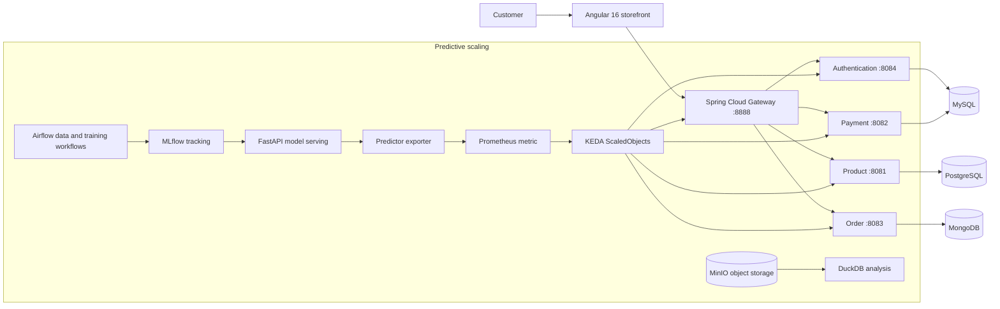

# Commerce Platform

**A cloud-native e-commerce portfolio project combining Spring Boot microservices, an Angular storefront, Kubernetes autoscaling, and an LSTM forecasting pipeline.**

The repository demonstrates how an independently deployable commerce backend can be paired with both reactive CPU-based scaling and a predictive scaling path. It includes local development dependencies, Kubernetes manifests, load-test assets, and observability configuration.

## Architecture



## What this project demonstrates

- **Service boundaries:** an API gateway fronts authentication, product, order, and payment services.
- **Polyglot persistence:** MySQL, PostgreSQL, and MongoDB are assigned to services with different data needs.
- **Two scaling strategies:** Kubernetes HPA policies use CPU utilization; KEDA policies consume Prometheus metrics for forecast-driven replica counts.
- **ML operations:** Airflow workflows and Kubernetes jobs prepare datasets, train LSTM/CNN-LSTM/TCN models, and support model tracking and drift analysis.
- **Observability and testing:** Prometheus, Grafana, Loki, Tempo, and Locust assets support metrics, dashboards, logs, traces, and repeatable load tests.

## Technology

| Area | Technologies |
| --- | --- |
| Web | Angular 16, Angular Material, Tailwind CSS |
| Services | Java, Spring Boot, Spring Cloud Gateway, JWT |
| Data | MySQL, PostgreSQL, MongoDB, DuckDB, MinIO |
| ML pipeline | Airflow, TensorFlow/Keras, MLflow, FastAPI |
| Platform | Docker Compose, Kubernetes, Helm, HPA, KEDA |
| Observability | Prometheus, Grafana, Loki, Tempo |

## Quick start

### 1. Configure runtime values

Provide secrets through Replit Secrets or your local process environment. Do not commit secret values.

- Core services: `JWT_SECRET`, `MYSQL_ROOT_PASSWORD`, `POSTGRES_PASSWORD`, `MONGO_INITDB_ROOT_PASSWORD`, and `SPRING_DATA_MONGODB_URI`.
- Predictive pipeline: `AWS_ACCESS_KEY_ID` and `AWS_SECRET_ACCESS_KEY` for the configured MinIO/S3 endpoint.
- `JWT_SECRET` must be the same Base64-encoded key of at least 256 bits for authentication, order, payment, and product services.

### 2. Start local databases

From the repository root:

```bash
docker compose -f backend/docker-compose.yml up -d mysql postgres mongodb
```

### 3. Run the backend

Run each service in its own terminal. For example:

```bash
cd backend/api-gateway
./mvnw spring-boot:run
```

The gateway listens on port `8888`. Service ports and database dependencies are listed in [`backend/README.md`](backend/README.md).

### 4. Run the storefront

```bash
cd frontend
npm ci
npm start
```

Open `http://localhost:4200`. The Angular development proxy forwards `/api` requests to the gateway at `http://localhost:8888`.

## Kubernetes and scaling

- [`backend/k8s/`](backend/k8s/) contains application and infrastructure manifests. Create the namespaces and provision secrets before applying workloads; the scripts require a configured `kubectl` context.
- [`HPA/`](HPA/) contains CPU-based policies for the five services.
- [`autoscaling-lstm/`](autoscaling-lstm/) contains the forecasting, predictor-exporter, and KEDA components.
- [`monitoring/`](monitoring/) contains Prometheus Helm value overrides; local observability containers are defined in `backend/docker-compose.yml`.

Use either the HPA policy or the KEDA `ScaledObject` for a given Deployment at a time. Both controllers change replica counts and should not compete for the same workload.

## Repository map

```text
.
├── autoscaling-lstm/   # Airflow, model pipeline/serving, MinIO, Locust, KEDA
├── backend/            # Gateway, four Spring services, databases, Kubernetes
├── frontend/           # Angular storefront
├── HPA/                # CPU-based Kubernetes autoscalers
└── monitoring/         # Prometheus Helm overrides
```

Each module README provides its own purpose and shortest setup path.
